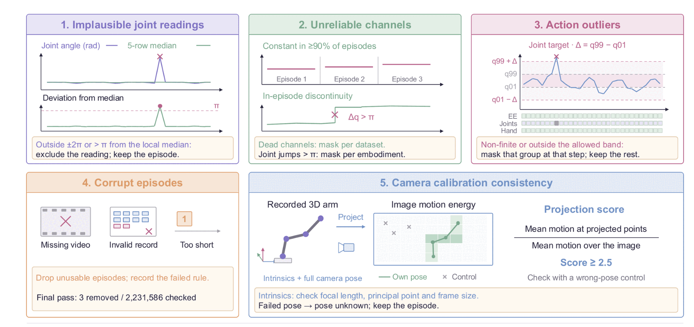

# NEO-VLA

A vision-language-action policy: the NEOpp-2B vision-language backbone with a
flow-matching action expert attached to 28 of its 40 layers (`skip28`). This
repository trains it in three stages:

| stage | launcher | trains | data |
|---|---|---|---|
| 1. pretrain | `scripts/stage1.sh` | action expert and prefix tokenizers, backbone frozen | robot corpus `gd7_tokens_nobw` |
| 2. co-pretrain | `scripts/stage2.sh` | everything, from the stage-1 EMA | `gd7_tokens_nobw` + MT_Und chat (packed) |
| 3. real-robot post-train | `scripts/posttrain_real.sh` | everything, from the stage-2 EMA | your real-robot corpus + MT_Und chat (unpacked) |

## Installation

Linux with NVIDIA GPUs (the reference runs used 80 GB GPUs), Python >= 3.10
and PyTorch >= 2.6 with CUDA.

```bash
conda create -n neo-vla python=3.10 -y && conda activate neo-vla
pip install torch torchvision          # the CUDA build for your driver
pip install -e .                       # torch, transformers, hydra-core, pyarrow, av, ...
pip install -e '.[object-store]'       # MT_Und images behind the object store (see below)
pip install -e '.[prep]'               # data preprocessing: h5py, scipy, OpenCV
pip install -e '.[dev]'                # optional development dependencies
```

You also need the **NEOpp-2B-SFT** checkpoint as a local directory (weights
and tokenizer). Runs load it from `NEO_VLA_BACKBONE`; the launchers set
`HF_HUB_OFFLINE=1` and `TRANSFORMERS_OFFLINE=1` unless you set them.

Every launcher accepts `--print-argv`: it prints this node's environment, the
`scripts/train.sh` command and the exact Hydra override list, and starts
nothing. Missing paths print as `<NAME>`, so you can inspect a recipe before
any data exists:

```bash
bash scripts/stage1.sh --print-argv
```

## Common environment

| variable | meaning |
|---|---|
| `NEO_VLA_BACKBONE` | NEOpp-2B-SFT checkpoint directory |
| `NEO_VLA_DATA_ROOT` | corpus root holding `manifests/<corpus>.json` and `prep_<corpus>/embodiments.json` |
| `NEO_VLA_OUTPUT_ROOT` | where run directories go: `<root>/<RUN_NAME>/checkpoints/step_<9 digits>` |
| `NEO_VLA_PYTHON` | interpreter to use (default `python`) |
| `NNODES`, `NODE_RANK`, `GPUS_PER_NODE`, `MASTER_ADDR`, `MASTER_PORT` | distributed shape (defaults 1, 0, 8, -, 29500) |
| `RUN_NAME`, `WORKERS`, `PREFETCH` | run name and loader workers / batches read ahead per worker |

Run the same command on every node with that node's `NODE_RANK`; the values
go to `torchrun` unchecked. Relaunching with the same `RUN_NAME` resumes from
the newest checkpoint. Anything after `--` is appended as a Hydra override.

Each recipe states its global batch; the accumulation is derived from the
world size (`NNODES x GPUS_PER_NODE`) and must divide exactly. The reference
shape of stages 1 and 2 is 16 nodes x 8 GPUs.

Keep the inductor cache (`TORCHINDUCTOR_CACHE_DIR`, `TRITON_CACHE_DIR`)
node-local; stages 1 and 2 compile layers with `torch.compile`.

Prompt caches record the exact checksum of `config/prompt_template/neo_v7.yaml`.
Build or re-render them with this file before training; caches made with a
different copy are rejected even when only its comments differ. Use the same
template throughout all three stages.

## Stage 1: pretrain

```bash
export NEO_VLA_BACKBONE=/path/to/NEOpp-2B-SFT
export NEO_VLA_DATA_ROOT=/path/to/corpus          # holds manifests/gd7_tokens_nobw.json
export NEO_VLA_OUTPUT_ROOT=/path/to/runs
NNODES=16 NODE_RANK=<r> MASTER_ADDR=<rank-0 host> bash scripts/stage1.sh
```

Recipe (`mode=frozen_vlm data=gd7 schedule=pretrain`): 113,400 steps x 8,192
samples (8 per GPU x accumulation 8 x 128 GPUs), about one pass of the
corpus rows; AdamW lr 2e-4, betas (0.9, 0.95), weight decay 1e-10, 2,000
warmup steps, cosine to 2e-5, gradient clip 1.0; EMA 0.99; seed 0; layers
compiled (`trainer.compile_layers`), prefix trimmed to 64-column buckets,
no gradient checkpointing; a checkpoint every 1,000 steps, the last 2 kept.

**Input.** The prepared robot corpus `gd7_tokens_nobw` (2,704 directories,
2,231,583 episodes, 928,401,030 rows from AgiBot, OXE, DROID, RH20T,
InternData-A1, RoboCOIN, Galaxea, RoboMIND and BimanualYAM), with its
manifest, cache and normaliser under `NEO_VLA_DATA_ROOT`. The corpus is not
distributed with this code, and the per-source converters that produced it
are not included; `config/layouts/gd7.json` documents its layout and
`config/data/gd7.yaml` its mixture (InternData-A1 fixed at 15%, the other
families by row count^0.43) and row sampling.

**Preprocessing.** [docs/preprocessing.md](docs/preprocessing.md) gives the
commands that turn converted directories into the manifest, cache and
normaliser. It covers five quality stages:

1. implausible joint readings are stored as NaN (`tools/sidecars/`);
2. dead and wrapping joint and hand channels are masked (`tools/build_stats.py`);
3. an out-of-band action target masks only its own group at that step;
4. corrupt episodes are dropped with a named reason
   (`tools/validate_episodes.py`, `tools/filter_episodes.py`);
5. camera calibrations are checked, and a pose that fails the projection QC
   becomes unknown while its episode is kept (`tools/qc_extrinsics.py`,
   `tools/build_cache.py --pose-qc`).

A summary of the processed corpus is in
[data_release/DATASET_CARD.md](data_release/DATASET_CARD.md).

## Stage 2: co-pretrain with MT_Und

```bash
export STAGE1_CKPT=$NEO_VLA_OUTPUT_ROOT/stage1/checkpoints/step_000113400
export NEO_VLA_MTUND_ROOT=/path/to/mtund_root     # mt_und_denylist.json, aoss-python-sdk-2.2.6/, aoss.conf
export NEO_VLA_MTUND_REGISTRY=/path/to/MT_Und.json
export NEO_VLA_MTUND_LINE_INDEX=/path/to/mtund_line_index
NNODES=16 NODE_RANK=<r> MASTER_ADDR=<rank-0 host> bash scripts/stage2.sh
```

Recipe (`mode=cotrain data=gd7_cotrain_mtund_native schedule=pretrain`):
initialised from the stage-1 checkpoint's EMA weights; 75,000 steps x 8,192
robot samples; lr 2e-4 for the expert and 5e-5 for backbone, vision tower and
chat head, 2,000 warmup steps, cosine to 2e-5; EMA 0.999 kept on the CPU and
excluding the backbone; seed 1; gradient checkpointing, with the robot path
compiled and only its first 12 of 40 layers recomputed. Every other step each
GPU adds one 36,864-token MT_Und pack, rendered in NEO's native chat format,
on its last micro-batch at loss weight 0.2222 (0.1111 averaged over steps).
A checkpoint every 5,000 steps, the last 2 kept.

**MT_Und inputs.**

- `NEO_VLA_MTUND_REGISTRY`: the MT_Und registry json (entries with
  annotation files, `length` and `repeat_time`).
- `NEO_VLA_MTUND_LINE_INDEX`: its line index, built once:
  `python tools/build_mtund_line_index.py --registry $NEO_VLA_MTUND_REGISTRY --out <new dir> --workers 16`.
- `NEO_VLA_MTUND_ROOT/mt_und_denylist.json`: a json list of registry keys to
  skip; the recipe uses `[]`. The registry contains verbatim MMMU and
  MMMU-Pro items, so those benchmarks are not held out for models trained here.
- Most registry images sit behind an S3-style object store read through the
  `aoss` client: its SDK directory `aoss-python-sdk-2.2.6/` and config
  `aoss.conf` go under `NEO_VLA_MTUND_ROOT`, and the `object-store` extra
  installs its dependencies. Without them the run stops;
  `-- data.train.understanding.object_store=exclude` instead trains only on
  the entries readable without the client, which changes the chat mixture.

## Stage 3: real-robot post-train with MT_Und

```bash
export STAGE2_CKPT=$NEO_VLA_OUTPUT_ROOT/stage2/checkpoints/step_000075000
export NEO_VLA_DATA_ROOT=/path/to/real_corpus     # manifests/$REAL_CORPUS.json
export REAL_CORPUS=my_robot
export REAL_FRAME_SET='my_robot_key=[[camera:1]]' # the wrist camera's slot per embodiment key
# NEO_VLA_MTUND_* as in stage 2
NNODES=2 NODE_RANK=<r> MASTER_ADDR=<rank-0 host> bash scripts/posttrain_real.sh
```

Recipe (`mode=cotrain data=real_cotrain_mtund schedule=finetune`): a full
fine-tune initialised from the stage-2 checkpoint's EMA weights; 30,000 steps
x 128 samples; lr 5e-5 for the expert and 2.5e-5 for backbone, vision tower
and chat head, 1,000 warmup steps, cosine to 1e-5, weight decay 1e-8; no EMA;
seed 42; gradient checkpointing; a checkpoint every 1,000 steps, the last
kept. MT_Und is always on, unpacked: one chat row per robot row at loss
weight 0.1, at most 1,003,520 pixels and 4,096 tokens per row. Set
`MAX_STEPS`, `GLOBAL_BATCH` and `PER_DEVICE_BATCH` (default 4) for your
corpus size and world size.

| variable | meaning |
|---|---|
| `REAL_CORPUS` | manifest name under `NEO_VLA_DATA_ROOT/manifests/` |
| `REAL_NORMALISER` | the post-train `embodiments.json` (default `prep_<REAL_CORPUS>/embodiments.json`) |
| `STAGE2_CKPT` | stage-2 checkpoint directory |
| `REAL_FRAME_MODE` | `wrist` (default): actions in one posed camera's frame per embodiment key; `random`: drawn per episode (or per sample, `REAL_FRAME_DRAW=sample`) among `REAL_FRAME_SET`; `none`: each directory's manifest `frame_ref` |
| `REAL_FRAME_SET` | `KEY=FRAMES` per embodiment key, space separated: `my_key=[[camera:1]]` (one entry per arm), or for random `my_key=[[robot],[camera:1]]` |

**Preparing the real-robot corpus.** The loader reads any schema-3 manifest
built by the preparation pipeline; it is not tied to one robot.

1. Convert raw recordings into source directories (per-episode parquet and
   video files with `meta/info.json` and `meta/episodes.jsonl`) with a
   converter for your robot; none is included here.
2. Describe the directories in a layout file (the schema `tools/layouts.py`
   reads; `config/layouts/gd7.json` is a full example) and give each new
   embodiment key a block in `config/embodiments.yaml` with `stage: finetune`
   (optionally `action_from: <pretrain key>`).
3. Build the manifest, cache and normaliser:

   ```bash
   python tools/prepare_data.py --root $NEO_VLA_DATA_ROOT --corpus $REAL_CORPUS \
       --prep-dir prep_$REAL_CORPUS --layouts config/layouts/my_robot.json \
       --dir <source dir> [--dir ...] --drop <rule> ... \
       --tokenizer $NEO_VLA_BACKBONE --tokenizer-id $NEO_VLA_BACKBONE \
       --stats-from $STAGE2_CKPT/embodiments.json --check-fit \
       [--inherit-action my_key=franka_panda] \
       [--stats-frame-policies camera:1]
   ```

   The prompt cache is stamped with `--tokenizer-id`, and the loader refuses
   a run whose `NEO_VLA_BACKBONE` string differs from it (or pass
   `-- data.train.tokenizer_id=<stamped id>`). `--stats-from` builds the
   normaliser against the stage-2 checkpoint's own keys; `--check-fit` and the
   run's start-up check hold every key to the normaliser's fit test. Use the
   ten `--drop` rules listed in [docs/preprocessing.md](docs/preprocessing.md)
   (stage 4). The layout file and `config/prompt_template/neo_v7.yaml` are
   read from under `--root`.

## Preprocessing and data



The [preprocessing guide](docs/preprocessing.md) describes the five filtering
stages. The [data release package](data_release/README.md) contains the processed
corpus card, source inventory and upload preparation tools.

## License

NEO-VLA code is licensed under [Apache-2.0](LICENSE). Upstream code and data retain
their applicable terms; see [third-party notices](THIRD_PARTY_NOTICES.md) and
[dataset terms](data_release/UPSTREAM_TERMS.md).
