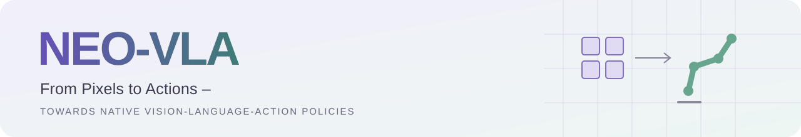
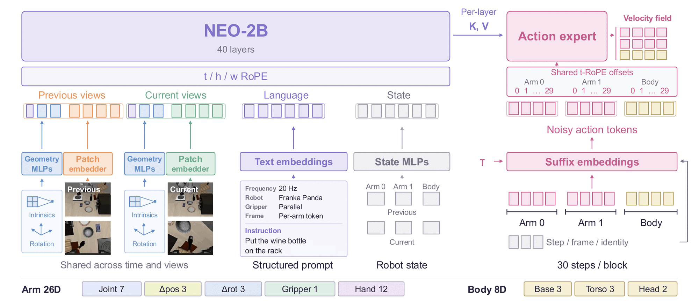
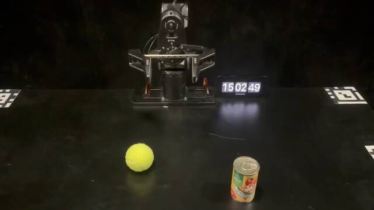
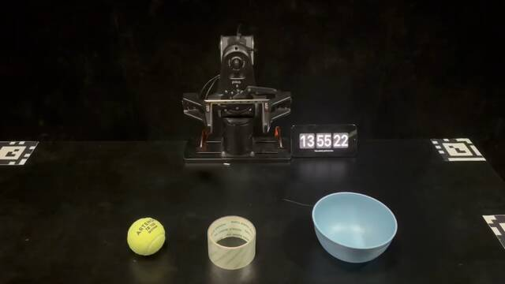
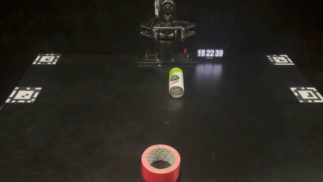
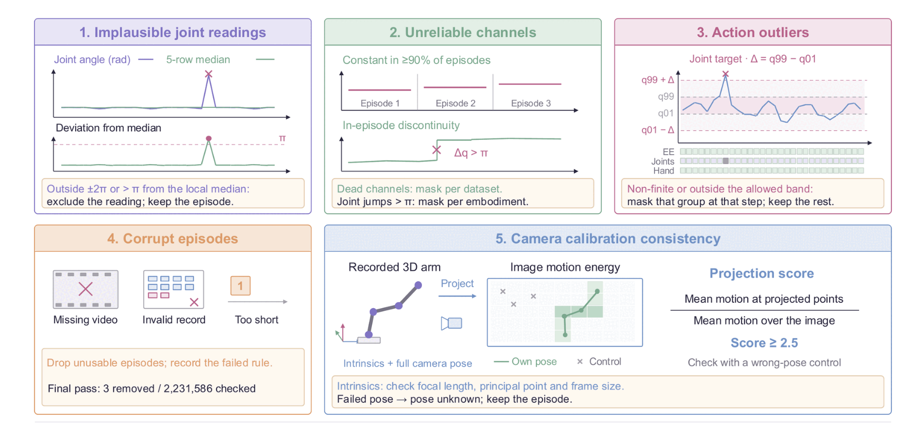

<p align="center">
  
</p>

<h2 align="center">From Pixels to Actions –<br>Towards Native Vision-Language-Action Policies</h2>

<p align="center">
  <a href="https://weichenfan.github.io/Weichen/">Weichen Fan</a><sup>1,*</sup>, <a href="https://paranioar.github.io/">Haiwen Diao</a><sup>1,*,♯</sup>, <a href="https://penghao-wu.github.io/">Penghao Wu</a><sup>1</sup>, <a href="https://sy-h.com/">Siyuan Hu</a><sup>1</sup>,<br>
  <a href="https://ziqihuangg.github.io/">Ziqi Huang</a><sup>1</sup>, <a href="https://tqtqliu.github.io/">Tianqi Liu</a><sup>1,3</sup>, <a href="https://mingzesun0514.github.io/">Mingze Sun</a><sup>1</sup>, Ziyi Wang<sup>1</sup>,<br>
  <a href="https://caizhongang.com/">Zhongang Cai</a><sup>2</sup>, <a href="https://scholar.google.com/citations?user=NSeqMYIAAAAJ">Hanming Deng</a><sup>2</sup>, <a href="https://scholar.google.com/citations?user=KmxEHm4AAAAJ">Quan Wang</a><sup>2</sup>, <a href="https://yanglei.me/">Lei Yang</a><sup>2</sup>, <a href="https://scholar.google.com/citations?user=zdgKJXIAAAAJ">Lewei Lu</a><sup>2</sup>,<br>
  <a href="https://hongfz16.github.io/">Fangzhou Hong</a><sup>3</sup>, <a href="https://frozenburning.github.io/">Zhaoxi Chen</a><sup>3</sup>, <a href="https://dahua.me/">Dahua Lin</a><sup>2</sup>, <a href="https://liuziwei7.github.io/">Ziwei Liu</a><sup>1,†</sup>
</p>
<p align="center">
  <sup>1</sup>S-Lab, Nanyang Technological University · <sup>2</sup>SenseTime Research · <sup>3</sup>Ropedia<br>
  <sub>* Equal contribution &nbsp; ♯ Project lead &nbsp; † Corresponding author</sub>
</p>

<p align="center">
  <a href="https://huggingface.co/papers/2611.06918"><b>📄 Paper</b></a> ·
  <a href="https://weichenfan.github.io/NEO-VLA-Page/"><b>Project Page</b></a> ·
  <a href="https://huggingface.co/datasets/weepiess2383/NEO-VLA-Action-Pretrain"><b>🤗 Dataset</b></a> ·
  <a href="https://huggingface.co/weepiess2383/NEO-VLA"><b>🤗 Model</b></a>
</p>
<p align="center">
  <a href="LICENSE"></a>
  <a href="pyproject.toml"></a>
  <a href="config/arch/skip28.yaml"></a>
</p>

## Overview

**NEO-VLA brings native vision-language modeling to robot control.** Images enter
through a lightweight patch embedder and are processed alongside language and
robot state in the NEO backbone. A flow-matching action expert reads the
backbone's intermediate representations to predict continuous action chunks.

- **Native visual input.** The policy uses NEO's patch embedder, without a separate vision encoder.
- **Structured robot context.** Multi-view observations, camera geometry, instructions and robot state share one prefix.
- **Continuous actions.** The action expert predicts 30-step chunks for two arms and a body slot.
- **Three-stage training.** Action pretraining, joint vision-language/action training and real-robot adaptation share one codebase.

## Method

<p align="center">
  
</p>

The 40-layer NEO-2B backbone processes previous and current observations, text
and state. The default `skip28` configuration connects the action expert to
28 backbone layers. Image tokens carry spatial and temporal positions; action
tokens carry step, frame and embodiment identity. The default action
representation supports 26 dimensions per arm and 8 body dimensions, with
unavailable targets masked by the data pipeline.

### Real-robot tasks

| Precise placement | Sequential manipulation | Object reorientation |
|:---:|:---:|:---:|
| [](https://weichenfan.github.io/NEO-VLA-Page/) | [](https://weichenfan.github.io/NEO-VLA-Page/) | [](https://weichenfan.github.io/NEO-VLA-Page/) |
| Tennis ball on can | Tape in bowl, then ball in tape | Stand can in tape |

Full demonstrations and experimental results are on the [project page](https://weichenfan.github.io/NEO-VLA-Page/).

## Getting started

Use Linux, Python 3.10 or later, and a CUDA-enabled PyTorch installation.

```bash
git clone https://github.com/EvolvingLMMs-Lab/NEO.git
cd NEO/VLAKit
conda create -n neo-vla python=3.10 -y
conda activate neo-vla
# Install the PyTorch CUDA build appropriate for your system first.
pip install -e .
pip install -e '.[prep]'  # for the camera-calibration filters
```

Set the backbone, processed robot corpus and output directories:

```bash
export NEO_VLA_BACKBONE=/path/to/NEOpp-2B-SFT
export NEO_VLA_DATA_ROOT=/path/to/robot-corpus
export NEO_VLA_OUTPUT_ROOT=/path/to/runs

# Inspect the complete command and configuration without starting training.
bash scripts/stage1.sh --print-argv
```

The backbone checkpoint and tokenizer are obtained separately. The robot corpus
must contain a manifest, prompt cache and normalizer. Use the processed
[NEO-VLA-Action-Pretrain](https://huggingface.co/datasets/weepiess2383/NEO-VLA-Action-Pretrain)
release, or a compatible corpus you prepare yourself.

## Training

| Stage | Trainable components | Robot data | Co-training data | Launcher |
|---|---|---|---|---|
| **1 · Action pretraining** | Action expert and prefix tokenizers | Processed pretraining corpus | — | [`stage1.sh`](scripts/stage1.sh) |
| **2 · Joint training** | Full policy | Processed pretraining corpus | Multimodal understanding data | [`stage2.sh`](scripts/stage2.sh) |
| **3 · Robot adaptation** | Full policy | Your real-robot corpus | Multimodal understanding data | [`posttrain_real.sh`](scripts/posttrain_real.sh) |

**Stages 2 and 3 co-train on multimodal understanding data.** COCO ShareGPT is
provided as the default example in the supplied configurations. The example
loader reads local ShareGPT4V-format image–text conversations:

```bash
export NEO_VLA_COCOGPTSHARE_RECORDS=/path/to/cocogptshare.json
export NEO_VLA_COCOGPTSHARE_IMAGES=/path/to/images
```

The example configurations use one unpacked chat row per robot row at a chat
loss weight of 0.1. Other image–text conversation datasets can be used by
providing compatible annotations and image paths, or by adding a dataset reader.
The project page reports the experimental settings used for its results.

The [training guide](docs/training.md) covers dataset layout, checkpoint
initialization, distributed launch commands and recipe parameters.

## Pretraining data

<p align="center">
  
</p>

The processed action corpus combines nine robot-data families: **2,231,583
episodes** and **928,401,030 rows** across 2,704 source directories. Five
filters exclude implausible joint readings, mask unreliable channels and
out-of-band action groups, drop corrupt episodes, and mark camera poses unknown
when calibration checks fail.

| Resource | Contents |
|---|---|
| [Dataset card](data_release/DATASET_CARD.md) | Corpus inventory, processing and data access |
| [Filter scripts](tools/) | The five filtering rules |

## Citation

```bibtex
@article{Fan2026NEOVLA,
  title   = {From Pixels to Actions--Towards Native Vision-Language-Action Policies},
  author  = {Fan, Weichen and Diao, Haiwen and Wu, Penghao and Hu, Siyuan and
             Huang, Ziqi and Liu, Tianqi and Sun, Mingze and Wang, Ziyi and
             Cai, Zhongang and Deng, Hanming and Wang, Quan and Yang, Lei and
             Lu, Lewei and Hong, Fangzhou and Chen, Zhaoxi and Lin, Dahua and
             Liu, Ziwei},
  journal = {arXiv preprint arXiv:2611.06918},
  year    = {2026}
}
```

## Acknowledgements and license

NEO-VLA builds on the NEO native vision-language backbone. We thank the authors
of [ShareGPT4V](https://github.com/ShareGPT4Omni/ShareGPT4V) and the robot datasets
listed in the [dataset card](data_release/DATASET_CARD.md).

Code is licensed under [Apache-2.0](LICENSE). Backbone weights, COCO images,
ShareGPT annotations and robot datasets retain their respective upstream terms;
see [third-party notices](THIRD_PARTY_NOTICES.md).
