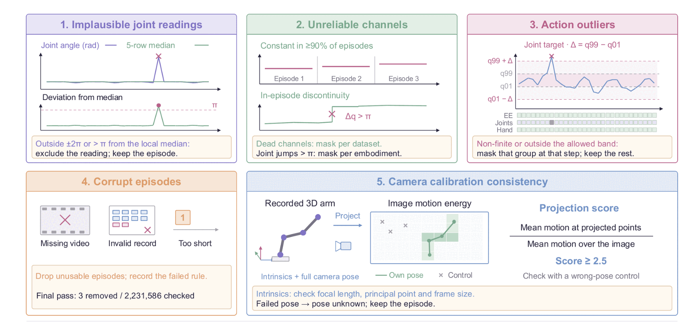

# Data filtering

The processed action-pretraining corpus and its normalization records are
published as a Hugging Face dataset,
[weepiess2383/NEO-VLA-Action-Pretrain](https://huggingface.co/datasets/weepiess2383/NEO-VLA-Action-Pretrain);
the upload is incremental and currently incomplete. This repository contains
the scripts for the five quality filters applied to that corpus. Source
conversion, manifest and cache construction, and normalizer estimation are not
part of this repository.

<p align="center">
  
</p>

| # | rule | script | effect on the data |
|---|---|---|---|
| 1 | implausible joint readings | `filter_joint_readings.py` | the reading becomes NaN (not recorded); the episode is kept |
| 2 | unreliable channels | `filter_channels.py` | dead channels masked per dataset directory, wrapping joints per embodiment |
| 3 | action outliers | `filter_action_outliers.py` | only the affected group is masked at that step |
| 4 | corrupt episodes | `validate_episodes.py`, `filter_episodes.py` | the episode is dropped and the rule that fired is recorded |
| 5 | camera calibration consistency | `validate_intrinsics.py`, `qc_extrinsics.py`, `qc_droid_extrinsics.py`, `filter_camera_poses.py` | a failed pose becomes unknown; the episode is kept |

Install the package (`pip install -e .`, plus `pip install -e '.[prep]'` for
the camera checks) and run the scripts from the repository root:

```bash
export PYTHONPATH=$PWD${PYTHONPATH:+:$PYTHONPATH}
R=$NEO_VLA_DATA_ROOT          # data root holding manifests/, metadata/, processed/ and episode directories
mkdir -p filtered
```

Paths given on the command line are ordinary paths. Directory names in
`--dir`, `--dirs-file` and in record files are relative to `--root`. Every
script writes to a new path given with `--out` (or `--out-dir`) and refuses to
overwrite an existing file or to write inside an input directory. JSONL outputs
start with a `{"provenance": {...}}` line naming the tool, its inputs and its
settings.

Episode directories follow the LeRobot layout: `meta/info.json`,
`meta/episodes.jsonl`, `data/chunk-*/episode_*.parquet` and
`videos/chunk-*/<camera>/episode_*.mp4`.

## 1. Implausible joint readings

Within one episode, a joint reading is excluded when it lies beyond ±2π rad,
or more than π from the median of the finite readings in the 5-row window
centred on it. The window is truncated at episode boundaries, and readings
beyond ±2π are left out of the median. Excluded and non-finite readings
become NaN; rows and episodes are kept. A sustained jump moves the median with
it, so a genuine wrap is left to rule 2.

```bash
python tools/filter_joint_readings.py --values joints.npy \
    --episode-starts episode_starts.npy --out filtered/joints.npz
# or one column of an Arrow/Feather/Parquet file with a per-row episode column
python tools/filter_joint_readings.py --values episode_000000.parquet \
    --column observation.joints --episode-column episode_index --out filtered/ep0_joints.npz
```

Input: `[rows, joints]` angles in radians, with episode start rows
`[episodes + 1]` (0 … rows) or a contiguous episode column. Output `.npz`:
`values` (float32, excluded → NaN), `excluded` (bool, same shape) and
`episode_starts`. The released corpus already stores joint readings filtered
this way.

## 2. Unreliable channels

- **Dead channel**, per dataset directory: a joint or hand column whose finite
  reading is constant over the whole episode in at least 90% of the
  directory's episodes that read it (episodes with no finite value are not
  counted).
- **Wrapping joint**, per embodiment: any step |q[t+1] − q[t]| > π between
  consecutive finite readings of one episode. Steps across episode boundaries
  are ignored. Counts are summed per embodiment key and arm slot over the
  directories holding that key; one such step masks the joint for the key.

```bash
python tools/filter_channels.py --root $R \
    --manifest $R/manifests/action_pretrain.json --out filtered/channels.json
```

Input: a schema-3 manifest and the Arrow caches, episode starts, embodiment
keys and trajectory weights it names. Output JSON: per directory
`dead_counts` (`[constant episodes, read episodes]` per slot and column),
`dead_dims`, `wrap_steps` and `wrap_masked`; per embodiment key and slot the
wrapped joints, their step counts and the steps checked. The released
`embodiments.json` records these masks per directory and key; the stored values
are not changed.

## 3. Action outliers

At each step, a target that is non-finite or outside
`[q01 − α(q99 − q01), q99 + α(q99 − q01)]` (α = 1 in the released normalizer)
masks only its own group at that step: end-effector, joints or hand for an arm;
base or posture for the body. The other groups at that step still train.
Bounds are the weighted q01/q99 of the released normalizer for each embodiment
key, slot and column; they are not re-estimated. The decision is made by
`neo_vla.data.embodiment.normalise_actions` and `normalise_body_actions`, the
functions the training loader uses.

```bash
python tools/filter_action_outliers.py \
    --normalizer $R/metadata/action_pretrain/embodiments.json \
    --dataset <manifest entry name> --key <embodiment key> --slot 0 \
    --targets targets.npy --out filtered/in_band.npz
```

Input: physical targets `[..., 26]` per arm (j0–j6, dx dy dz, drot_x drot_y
drot_z, gripper, h0–h11) or `[..., 8]` with `--body`. Output `.npz`:
`in_band` per column (each column carries its group's flag), `group_<name>`
per group and `dims_valid`, the directory's trained columns. Nothing is
removed from the stored data.

## 4. Corrupt episodes

```bash
python tools/validate_episodes.py --root $R --dirs-file dirs.txt \
    --layouts config/layouts/action_pretrain.json --out filtered/validation.jsonl
python tools/filter_episodes.py --root $R --validation filtered/validation.jsonl \
    --out filtered/kept.jsonl \
    --drop data_file_missing --drop episode_unreadable --drop rows_mismatch \
    --drop frames_missing --drop episode_too_short --drop state_width_mismatch \
    --drop action_width_mismatch --drop not_finite --drop quaternion_not_unit \
    --drop action_equals_state
```

`validate_episodes.py` writes one record per episode with its named defects:
a missing, unreadable or truncated data file, an absent or empty video
(`frames_missing`), fewer than `--min-rows` rows (default 2), state or action
widths that disagree with the layout, non-finite values outside columns the
layout marks as not recorded, quaternions off unit norm, actions equal to the
state, and further defects that are reported but not used for dropping.
`filter_episodes.py` drops an episode on the first listed rule its defects
match and writes a `dropped` record with that rule and the value that fired it;
every other episode gets a `kept` record with its position in the directory's
kept list. It refuses to write unless kept + dropped = validated, and refuses
to keep an episode with no readable data unless `--keep-unreadable` is given.
The ten rules above were used for the released corpus; the original pass
recorded 3 removals out of 2,231,586 checked episodes.

## 5. Camera calibration consistency

**Intrinsics.** Calibration records are JSONL, one per (dataset, episode,
view), with `fx`, `fy`, `cx`, `cy`, the `width` and `height` they were measured
against, and `provenance`.

```bash
python tools/validate_intrinsics.py --root $R \
    --intrinsics calibrations_agibot.jsonl --out filtered/intrinsics_validation.jsonl
```

Each record is checked for non-positive focal lengths or frame size, a pixel
aspect differing by more than 3% from its view's median, a principal point more
than 10% of the side from the centre or outside the frame, a horizontal field of
view outside 40–140° or vertical outside 30–120°, a calibration aspect that
disagrees with the frame size stored in `meta/info.json`, duplicates, and a
provenance the loader does not accept.

**Projection check.** The arm is the only moving object in these scenes. The
recorded 3-D arm points are projected through the intrinsics and the full
camera pose onto an image-motion map (blurred absolute frame differences). The
score is the mean motion at the projected points divided by the mean motion
over the image: at least 2.5 is `ok`, below is `fail`, and fewer than 30
samples (or no calibration, pose or video) is `inconclusive`. `--control`
scores every episode a second time under a deliberately wrong pose (another
directory's pose at least 10° away for AgiBot, another lab's pose for DROID),
and the header reports how often the episode's own pose scores higher
(`win_rate`).

```bash
# AgiBot head camera: all episodes (no --sample), with the wrong-pose control
python tools/qc_extrinsics.py --root $R --source agibot --control \
    --calib <AgiBot pose tree holding head_extrinsic_sidecar.jsonl> \
    --intrinsics calibrations_agibot.jsonl --dirs-file agibot_dirs.txt \
    --layouts config/layouts/action_pretrain.json \
    --out filtered/qc_extrinsics_agibot.jsonl --workers 32
# DROID exterior cameras: same score and threshold, other-lab control
python tools/qc_droid_extrinsics.py --root $R --control --calib <DROID pose tree> \
    --dirs-file droid_dirs.txt --urdf <Franka Panda URDF> \
    --out filtered/qc_droid.jsonl --workers 32
```

`qc_droid_extrinsics.py` needs a Franka Panda URDF supplied by you; it is
third-party and not distributed here.

**Failed poses.** `filter_camera_poses.py` marks the pose of every `fail`
episode as unknown (a NaN rotation) in a copy of that camera's per-episode
rotation array; `ok` and `inconclusive` poses are unchanged and no episode is
removed. It accepts only a complete `qc_extrinsics.py` run with `--control`
(no `--sample`, threshold 2.5, verdict counts matching the records) and only
cameras whose manifest extrinsics are per-episode from a separate pose file.
Rows follow the kept order in `kept.jsonl`.

```bash
python tools/filter_camera_poses.py --root $R \
    --manifest $R/manifests/action_pretrain.json --kept filtered/kept.jsonl \
    --pose-qc filtered/qc_extrinsics_agibot.jsonl --out-dir filtered/poses
```

Output: a corrected copy of each array holding at least one failed pose, at
`filtered/poses/<manifest-relative path>` (other arrays need no change), and
`pose_qc_summary.json` with verdict counts, kept episodes per verdict and the
number of poses marked unknown. With an unknown pose the loader no longer uses
that camera as the action frame. The DROID scores are a report: DROID poses
are stored in episode metadata, not in a separate pose file.

The released processed cache does not yet record a completed projection
census for the AgiBot head camera, so rule 5's pose masking is not certified
for the current release (see the [dataset card](../data_release/DATASET_CARD.md)).
